# Camera choreography & markers (WS2)

Code: [`src/map/controller/`](../src/map/controller) (`choreography.ts` pure planner, `MapController.ts`
executor) and [`src/map/markers/markersLayer.ts`](../src/map/markers/markersLayer.ts). Spec: `PLAN.md §6`,
`docs/workstreams/WS2-camera-markers.md`. Dev page: `pnpm dev`, then
`/src/map/controller/dev.html` (`?rm=1` reduced motion, `?hud=0` hides the buttons). It uses the terrain spike's
style inline (EOX Sentinel-2 + AWS terrarium DEM, exaggeration 1.5, sky) until WS1's `buildStyle` lands.

## Flight plans

`planFlight(from, to, reducedMotion, { viewport })` returns one of:

| Case | Steps |
|---|---|
| reduced motion | `jumpTo` target, masked by a 300 ms canvas fade (150 out + 150 in) |
| `from` null (first selection from the overview) | `flyTo` (speed 0.6, curve 1.42) |
| camera already at the target (re-select) | none; the marker just pulses |
| target < 150 km away (great circle) | `easeTo` target centre/zoom/bearing, **current pitch kept**, 1.5 s at ~0 km → 3.2 s at 150 km (linear) |
| otherwise | `easeTo` rise (zoom − 5, floor 4.2, pitch 0, bearing 0, 900 ms, ease-in-out sine) → `flyTo` |
| …already zoomed out and flat | the rise is skipped: `flyTo` only |

Target pose: `zoom 10.5, pitch 62, bearing −18`, each overridable by `nation.view`, clamped to zoom 8–13 and
pitch 0–75. `planOverview(from, reducedMotion)` flies back to `OVERVIEW_CAMERA` (1.5–3.5 s) or jumps.

### Deviation: speed 0.6 does not fit the time budget

`docs/contracts.md` says a flight takes 2.5–4.5 s and never more than 6 s. With `speed: 0.6` MapLibre's van
Wijk flight alone takes far longer at these distances (computed with the same formula MapLibre 6.17 uses,
`flyToDurationMs`, 1280×800 viewport):

| Transition | Distance | flyTo at speed 0.6 | + rise | Spec total |
|---|---|---|---|---|
| Overview → Y6 | 1,960 km | 5.8 s | — | 5.8 s |
| W9 → T2 | 3,013 km | 7.1 s | 0.9 s | 8.0 s |
| A43 → S64 | 2,294 km | 6.3 s | 0.9 s | 7.2 s |
| N198 → L3 | 2,427 km | 6.3 s | 0.9 s | 7.2 s |
| D62 → S64 | 201 km | 4.1 s | 0.9 s | 5.0 s |

So every `flyTo` step carries an explicit `duration`: the speed-0.6 duration clamped so the whole flight lands in
2.5–4.2 s (4.2 s leaves headroom under 4.5 s). The curve (1.42) and therefore the path are unchanged; the camera
just moves along it faster (effective speed ≈ 0.75–1.3 for these flights). `speed`/`curve` stay in the
step for reference. Explicit durations also let the controller tell a finished step from an interrupted one.

## Measured timings

Headless Chromium (ANGLE/Metal, Apple M5 Max), 1280×800, live tiles, `performance.now()` around
`controller.flyToNation(next, prev)`; each flight starts parked on the previous nation at its arrival pose with
tiles loaded. Camera sampled every animation frame (zoom, pitch, centre elevation, camera altitude, terrain under
the camera). The mock data has no Torres Strait, Kimberley or neighbouring-VIC entries, so the closest mock
transitions stand in for the brief's five.

| Transition (brief equivalent) | Steps: planned → measured | Total | Zoom start → min → end | Centre elev. start → end | Min camera clearance | Frame p95 / max | Handoff max frame |
|---|---|---|---|---|---|---|---|
| Overview → Djagaraga Y6, Cape York (overview → Torres Strait) | flyTo 4200 → 4210 | **4.21 s** | 3.7 → 3.7 → 10.5 | 463 → 46 m | 29.8 km | 17.2 / 17.3 ms | — |
| Wajuk W9 → Oyster Bay T2 (Perth → Hobart) | easeTo 900 → 913, flyTo 3300 → 3317 | **4.23 s** | 10.5 → 4.6 → 10.5 | 538 → 286 m | 22.7 km | 16.8 / 17.2 ms | 16.8 ms |
| Ngaatjatjarra A43 → Dharug S64 (Uluru → Sydney) | easeTo 900 → 913, flyTo 3300 → 3317 | **4.23 s** | 10.5 → 5.0 → 10.5 | 920 → 1886 m | 26.9 km | 17.3 / 17.7 ms | 17.0 ms |
| Dhuwal N198 → Kaurna L3 (Kakadu → Kimberley: long north–south hop) | easeTo 900 → 913, flyTo 3300 → 3316 | **4.23 s** | 10.5 → 5.0 → 10.5 | 147 → 38 m | 25.1 km | 17.4 / 17.6 ms | 17.1 ms |
| Canberra D62 → Dharug S64 (closest real pair, 201 km) | easeTo 900 → 915, flyTo 3300 → 3317 | **4.23 s** | 10.5 → 5.5 → 10.5 | 1120 → 1886 m | 24.8 km | 17.4 / 17.7 ms | 17.7 ms |
| Dja Dja Wurrung S31.1 → synthetic point 80 km east (two VIC neighbours)¹ | easeTo 2873 → 2880 | **2.88 s** | 10.5 → 10.5 → 10.5 | 362 → 285 m | 23.7 km | 17.3 / 17.6 ms | — |
| Oyster Bay T2 → overview (`flyToOverview`) | flyTo 3500 → 3511 | **3.51 s** | 10.5 → 3.7 → 3.7 | 286 → 463 m | 22.7 km | 16.8 / 17.0 ms | — |
| Reduced motion: W9 → T2 | jumpTo (fade) 300 → 302 | **0.30 s** | 10.5 → 10.5 | 538 → 427 m | 22.7 km | — | — |

¹ Measured before the near-branch floor was lowered from 2.5 s to 1.5 s; with the current constants this hop
plans 2.41 s (see "Real data" below for measured short hops).

Elevations include the 1.5× terrain exaggeration. "Handoff max frame" is the longest frame within ±100 ms of
the rise → flyTo boundary. A second run (with screenshots) reproduced the totals within 3 ms.

**No sea-level dip:** in every flight the centre elevation stays between its start and end terrain values (it
never falls towards 0 while over land) and the camera stays ≥ 22 km above the terrain beneath it; the dip
detector (centre elevation < 1 m over land, or a > 50 % drop in one frame) found 0 events. MapLibre 6.17 eases
the centre elevation towards the destination terrain and re-aims smoothly when DEM tiles land mid-flight, which
is visible as a gentle non-monotonic centre elevation in W9 → T2 (538 → 409 → 432 m in the screenshot run).

**No jank at the handoff:** the rise ends at zero velocity (ease-in-out) and the next `flyTo` is started from
the rise's `moveend`, in the same frame; frame times stay at 16.7 ms around the boundary. The one visible
artefact is imagery streaming in during the descent on a cold cache (below), which is tile latency, not camera.

## Still frames

Mid-rise, mid-flight and arrival (after tiles loaded) for each transition. Dark areas mid-flight are tiles not
loaded yet (fresh headless profile; the free hosts take 0.5–2 s per batch); the dark colour is the style
background.

| | Rise / early | Mid-flight | Arrival |
|---|---|---|---|
| Overview → Y6 | 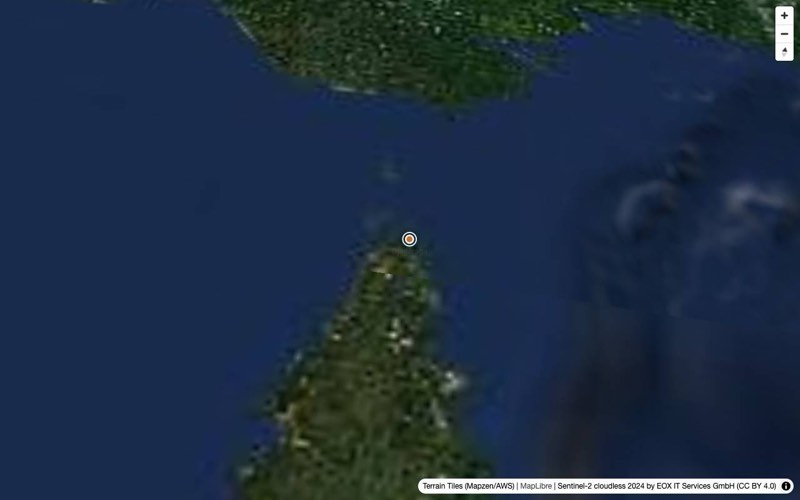 | 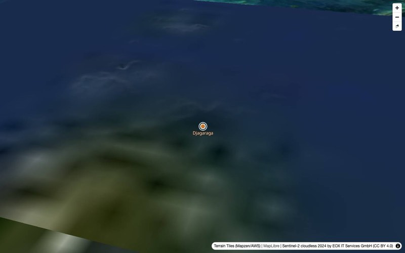 | 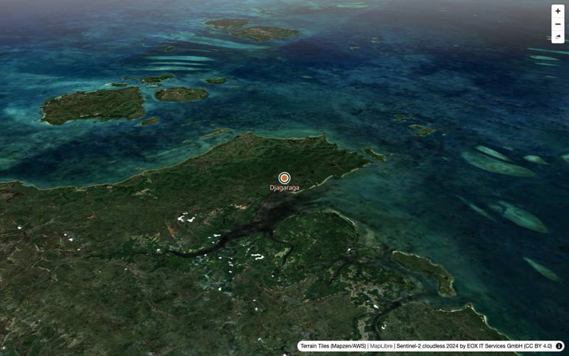 |
| W9 → T2 | 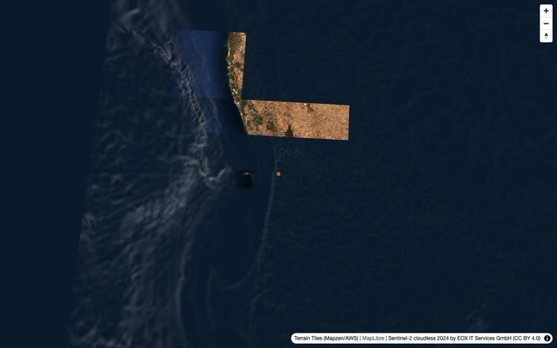 | 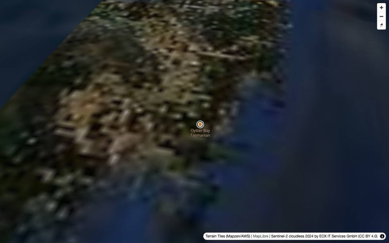 |  |
| A43 → S64 | 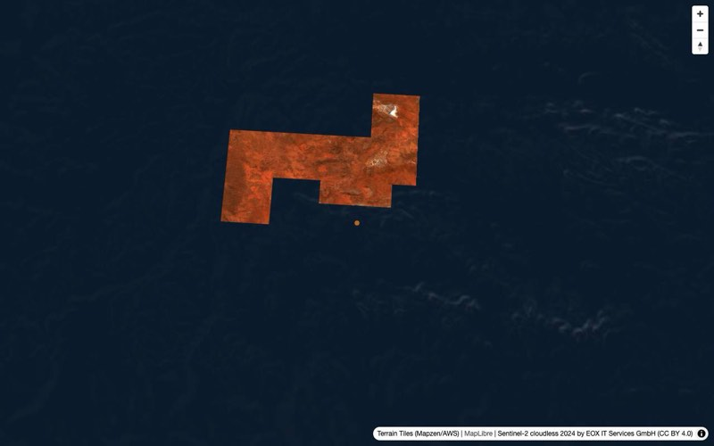 | 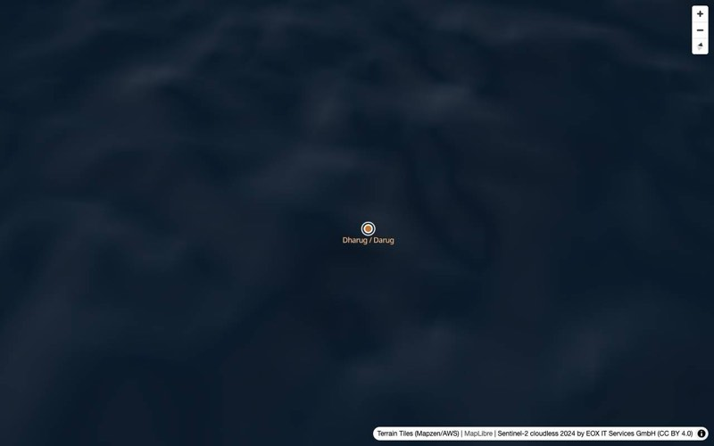 | 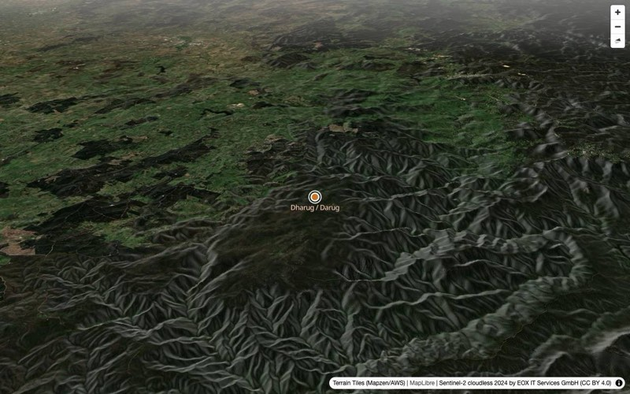 |
| N198 → L3 | 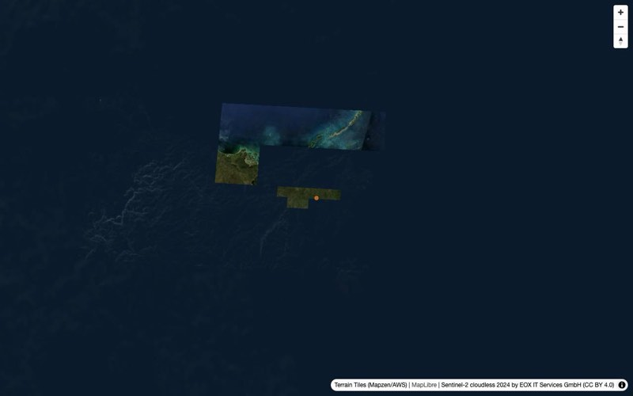 | 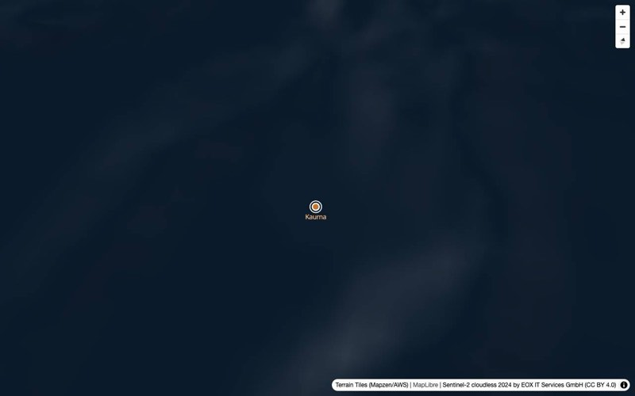 | 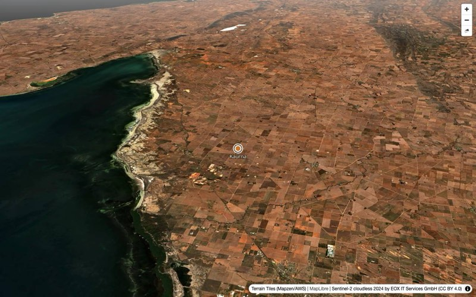 |
| D62 → S64 | 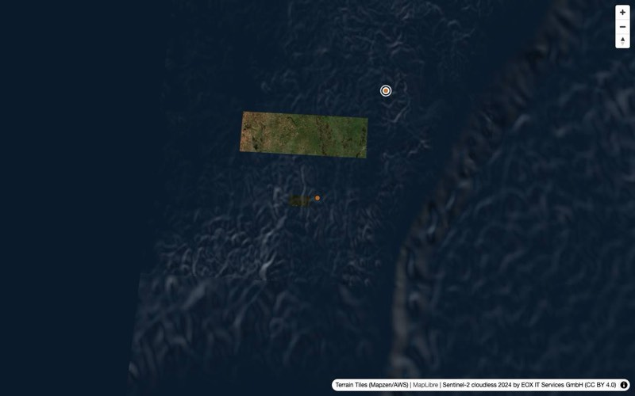 | 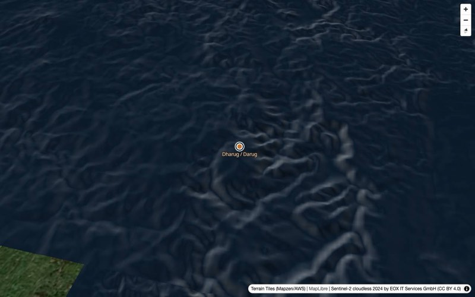 |  |
| S31.1 → +80 km (near) | 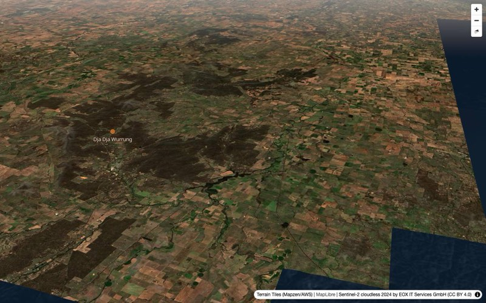 | 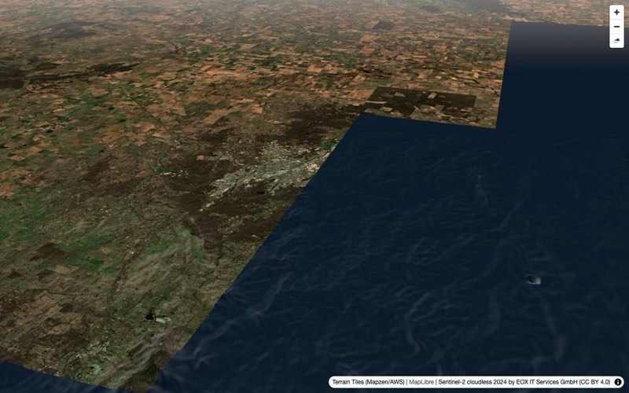 | 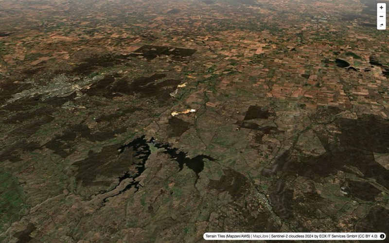 |
| T2 → overview | | 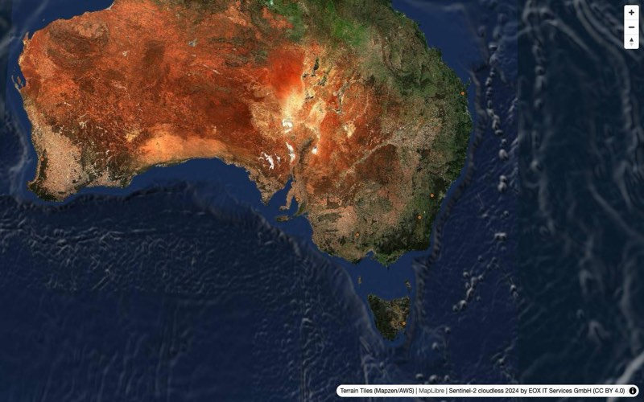 | 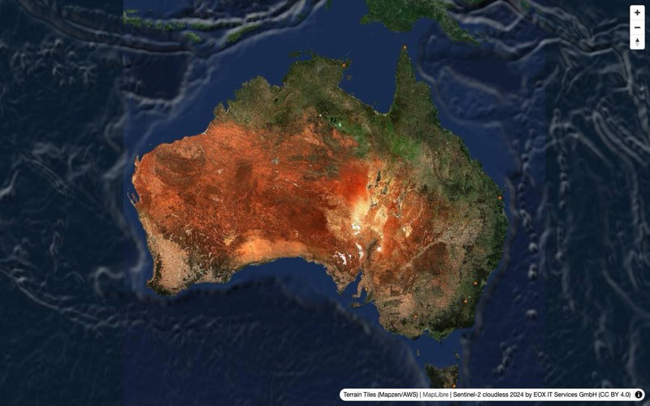 |
| Reduced motion W9 → T2 | 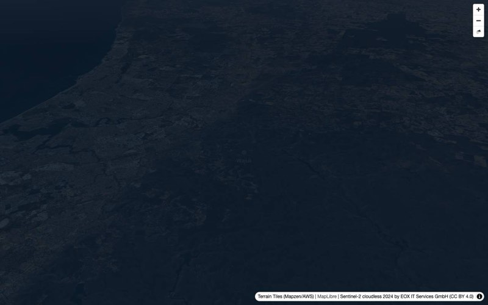 (mid-fade) | | 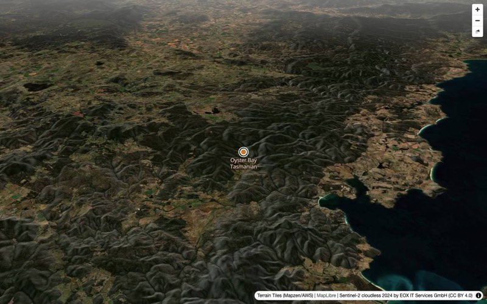 |

The near transition's target is synthetic, so it has no marker.

## Real data (WS3's 455 nations)

Same harness with `?nations=<url>` pointed at WS3's `public/data/nations.json` (branch `ws3-data-pipeline`,
455 nations, 18 `view` overrides), live tiles:

| Transition | Plan | Measured | Frame p95 | End pose (zoom / pitch / bearing) |
|---|---|---|---|---|
| G29 → Y93 (~1 km apart) | easeTo 1512 | 1.52 s | 17.7 ms | 10.5 / 62 / −18 |
| N179 → N181 (~1 km apart) | easeTo 1511 | 1.52 s | 17.9 ms | 10.5 / 62 / −18 |
| A43 (override zoom 9.5) → S64 (override zoom 11, pitch 70) | easeTo 900 + flyTo 3300 | 4.23 s | 17.9 ms | 11 / 70 / −18 |
| W9 → T10 (override zoom 11, pitch 70, bearing 0) | easeTo 900 + flyTo 3300 | 4.23 s | 17.2 ms | 11 / 70 / 0 |

Near-zero hops take the glide branch (no rise) and finish in ~1.5 s; overrides are honoured; a click at the
pitch-70 arrival hits the marker; a `mousemove` hit test over the dense south-east costs ~0.16 ms (max 1.3 ms).
No console errors or warnings. All 455 markers at the overview:

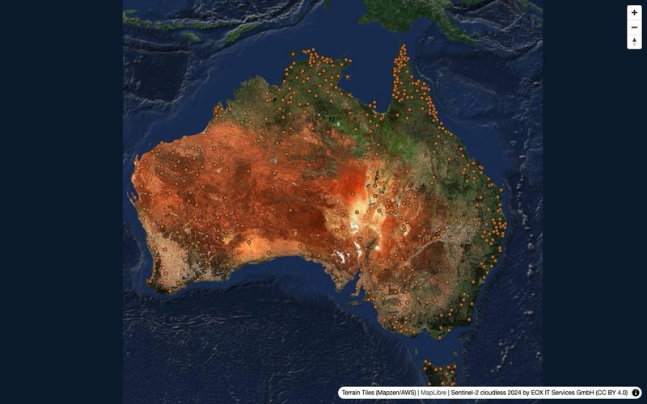

## Markers on terrain

Source `nations` (GeoJSON, `promoteId: 'idx'`; properties `idx`, `code` = `Nation.id`, `name`). Layers, bottom to
top, inserted before `LAYER_LABELS_FIRST` when the style has it:

- `nations-selected-ring`: white ring filtered to the selected code; pulses twice over 1.2 s on arrival
  (`circle-radius` / `circle-stroke-opacity` set per `requestAnimationFrame`, transitions off), then rests.
- `nations-circle`: 3 px at z3 → 7 px at z10, ochre `#c8742c` at 0.85 opacity, dark stroke; `hover` →
  lighter fill; `selected` → white 2.5 px stroke. No clustering.
- `nations-label`: `name`, `minzoom` 6.5, variable anchor, haloed, no overlap. Needs `glyphs` in the style
  (skipped with a warning otherwise); font defaults to `Noto Sans Regular` (OpenFreeMap's), configurable.

**`circle-pitch-alignment: 'viewport'`** (and `circle-pitch-scale: 'viewport'`). MapLibre already draws circles
at the terrain elevation of their point, so they don't sink below ridges either way; the choice is about
legibility. At pitch 75 `'map'` lays the disc flat on the ground and it collapses into a sliver, while
`'viewport'` keeps a round, constant-size, clickable marker:

| `'viewport'` (chosen), pitch 75 | `'map'`, pitch 75 |
|---|---|
| 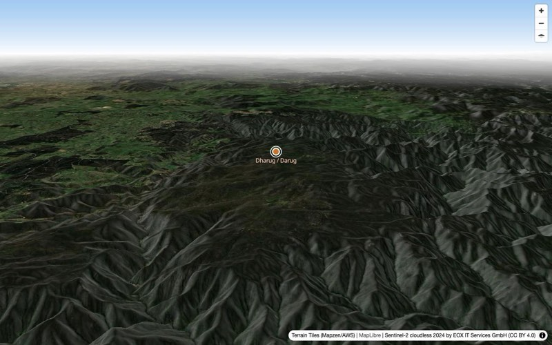 | 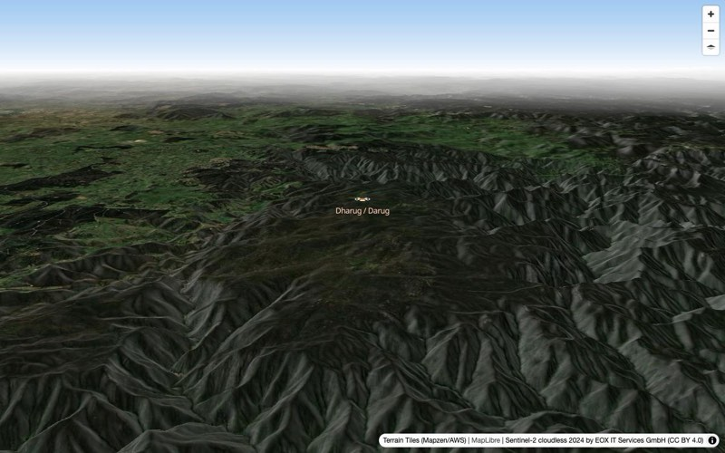 |

**Hit testing.** Clicks and hover query `nations-circle` in an 8 px box (markers are 4–8 px). MapLibre 6.17's
`queryRenderedFeatures` returns *no* circle features at all above about 70° pitch (measured: works at 64–70°,
empty at 72°+, with and without terrain, both alignments), even though they are drawn. Above 60° pitch a
miss falls back to projecting every nation with `map.project` (terrain-aware) and taking the nearest within
8 px. Worth an upstream issue.

## Controller behaviour (for WS5)

- `new MapController(map, { reducedMotion, onCameraState })` after the map's `load`. It adds the markers
  immediately if it can and otherwise on `style.load`; it re-adds them if the style is ever replaced.
- `flyToNation(n, prev)`: stops any running animation (`map.stop()`), sets `flying`, marks `n` selected, waits
  for terrain (one `idle`, max 2 s) if the style has none yet, plans from the **current camera** (from `null` is
  honoured only when the camera is actually near the overview), runs the steps awaiting each `moveend`, sets
  `idle`, pulses the marker. The promise **always resolves, never rejects**: on arrival, or early when a newer flight, a user gesture or
  `destroy()` interrupts it (check `cameraState` or your own token if you need to know which).
- Interruption: a newer `flyToNation`/`flyToOverview` wins; the old promise resolves and does not touch
  `cameraState`. A user drag/zoom mid-flight ends the flight (`idle`) instead of fighting the user — detected
  because the step's `moveend` arrives before its duration has elapsed.
- `reducedMotion()` is read at the start of every flight. Animated steps pass `essential: true` so MapLibre's
  own reduced-motion check doesn't override the app's decision.
- `setSelected(id | null)`, `setHovered(id | null)` set feature-state by `Nation.id`; unknown ids are ignored and
  the selection survives `setNations`.
- `onMarkerClick(cb)` → `cb(Nation.id)`; returns an unsubscribe. **Not in the contract yet:**
  `onMarkerHover(cb)` (`cb(id | null)`) for map → list hover, and `onStep` (debug timing hook used by the dev
  page). `cameraState` getter for tests.
- Map → store hover: use `onMarkerHover` rather than `map.on('mousemove', 'nations-circle', …)`. Layer events
  go through `queryRenderedFeatures`, which finds nothing above ~70° pitch; `onMarkerHover`/`onMarkerClick`
  use the 8 px tolerance and the projection fallback, and the controller already sets the pointer cursor and
  the `hover` feature-state. The `nations` source, `nations-circle` layer id and `code` property are stable
  either way.
- `destroy()` before `map.remove()`.

## Reproducing

```bash
pnpm dev --port 5202
# open http://localhost:5202/src/map/controller/dev.html
# console: await __ws2.select('W9'); __ws2.startSampling(); await __ws2.select('T2'); __ws2.stopSampling()
```

`tests/playwright/camera.spec.ts` drives the same page with mocked tiles (flat DEM) and checks the step plans,
`flying → idle`, the budget, cancellation, user-gesture interruption, marker clicks (incl. pitch 75), reduced
motion and `flyToOverview`. It needs the Vite dev server as `baseURL`.

## Known gaps

- Measured on the spike style with AWS terrain, not WS1's Mapterhorn style or its label layers (so marker
  labels vs basemap labels collision is unchecked).
- Imagery pops in during the descent on a cold cache. A shorter flight makes this slightly more visible; WS1/WS5
  could raise `maxTileCacheSize` or keep `raster-fade-duration` short.
- Frame timings are from a 60 Hz headless Metal context; WS6's FPS test should repeat this in a real window.
- `data/overrides.json` values are WS3's untuned seeds; tuning them per nation is still open (proposals go to WS3).
