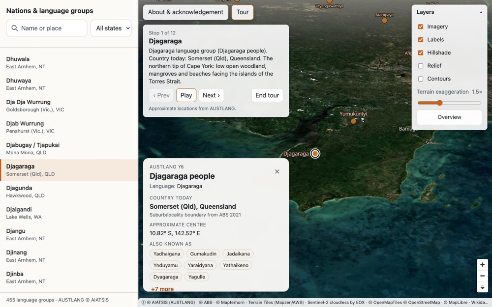
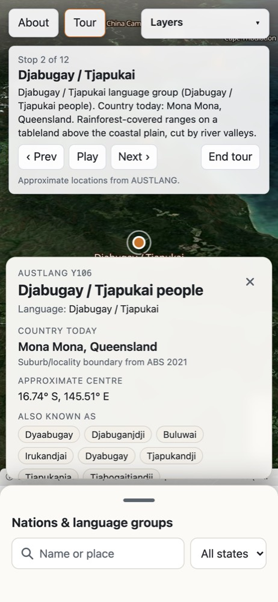
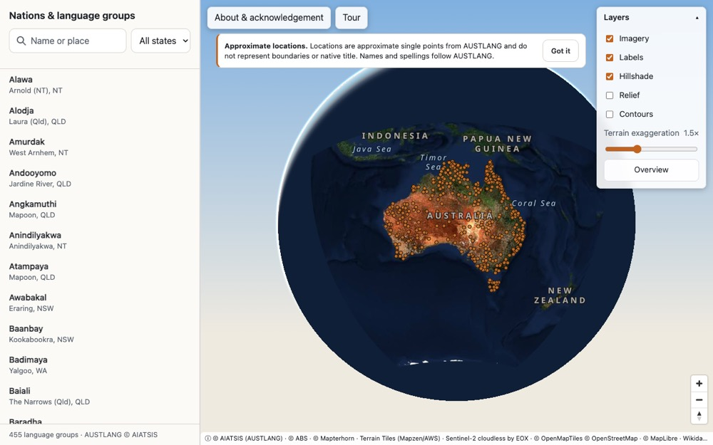
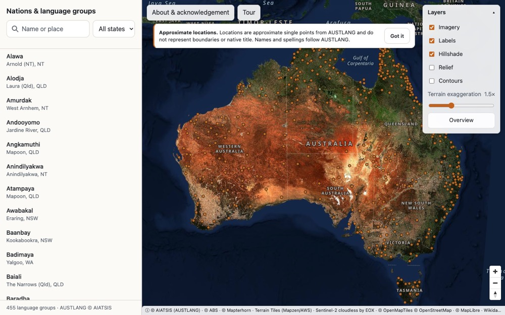
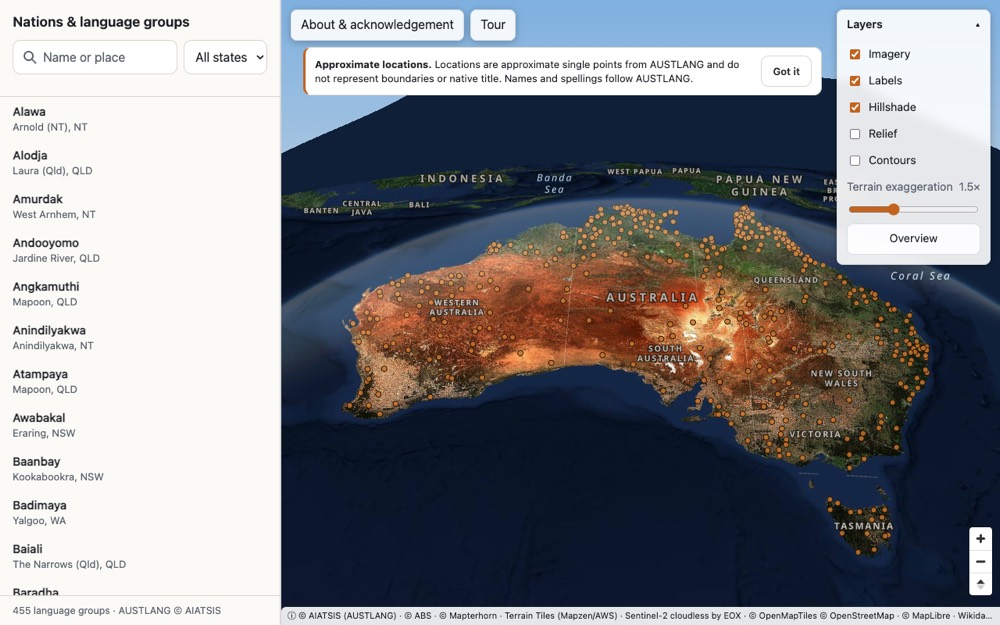
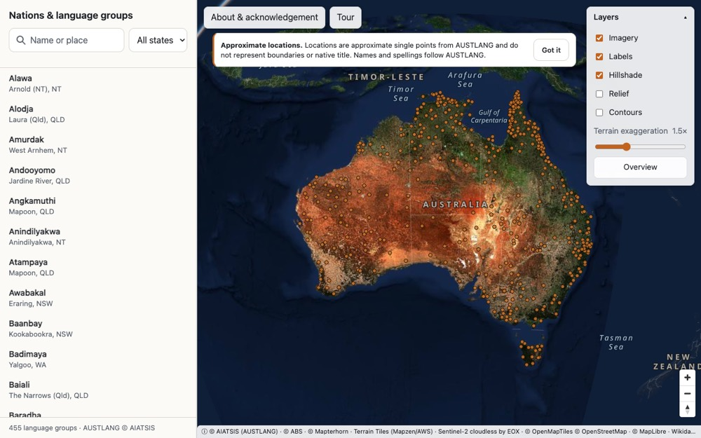
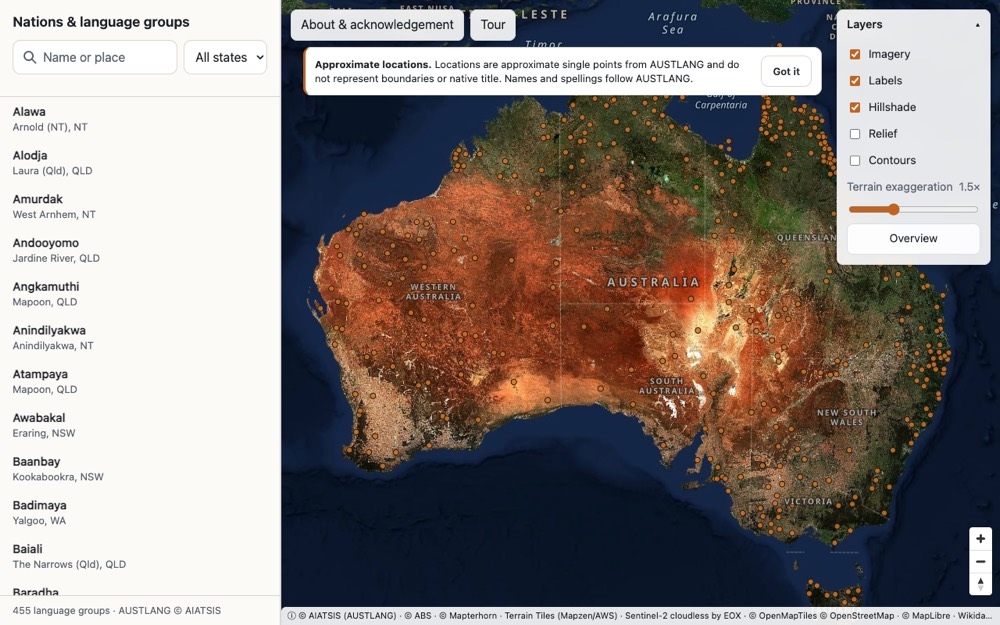
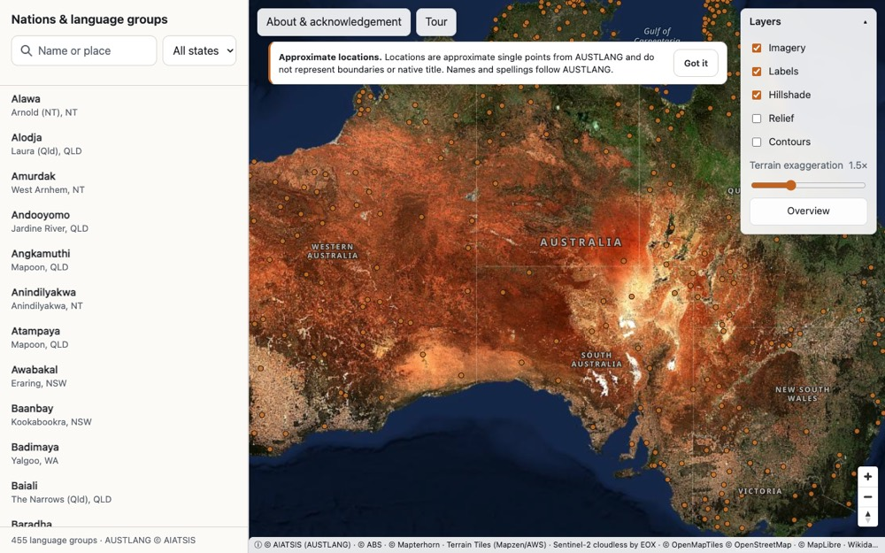

# Guided tour — stops and narration (WS9)

**Status: DRAFT. Every narration below needs the owner's review before release.**

The tour (`Tour` button, top-left of the map) visits 12 nations in a loop around the continent: it flies to
each one, waits until the camera has landed, lingers about 8 s, and moves on. Code:
[`src/app/tour/`](../src/app/tour) (`stops.ts` is the stop list and narration builder, `machine.ts` the state
machine, `driver.ts` runs it against the store, `Tour.tsx` the button and panel).

## Narration rules (binding, PLAN.md §8)

Each narration is assembled at runtime from three parts:

1. **From `nations.json` only:** `{name} language group ({peopleName}).` (the AUSTLANG name and people name).
2. **From `nations.json` only:** `Country today: {locality}, {state}.` (the ABS locality and state, as on the
   info card).
3. **One neutral landscape sentence** written for the tour (`landscape` in `stops.ts`): physical geography only
   (landform, vegetation, water). No cultural claims, history, stories, or words from the language. "Nation",
   "people", "language group", "Country"; never "tribe".

Parts 1 and 2 cannot drift from the data. Part 3 is the only hand-written text, so it is what needs review.
A unit test (`src/app/tour/tour.test.ts`) fails if a narration below no longer matches the code.

### For the owner to decide

- **Wording of every landscape sentence** (below). They describe the country around the AUSTLANG point, which
  is approximate; please check each against what the camera actually shows.
- **Modern geographic names in landscape sentences:** Cape York, Torres Strait, Gulf of Carpentaria, Murray
  River, Tasmania, Blue Mountains. These are today's map names, not facts from our data. Keep them, or replace
  them with purely descriptive wording?
- **Torres Strait:** the brief asks for an island stop in the Torres Strait, but the dataset has no Torres
  Strait Island languages (no Kalaw Lagaw Ya or Meriam Mir entry among the 455 with coordinates). The nearest
  is Djagaraga (`Y6`) at Somerset on the tip of Cape York, facing the Strait; Yanyuwa (`N153`, Pellew Islands)
  is the island stop. Worth raising with WS3 / the data owner.
- **People names** are shown exactly as in `nations.json` (`thesaurus_heading_people`), including "Palawa
  people" for South-western Tasmanian and the doubled "Djagaraga language group (Djagaraga people)" pattern.
- **Disclaimer banner during the tour:** the tour panel takes the first-visit banner's place while it is up
  (see Behaviour). OK, or should the panel move instead?
- **Order and choice of stops:** north → west → south → east, chosen for state coverage, landscape variety and
  existing camera overrides (`data/overrides.json`). The ACT is not included (the brief asks for every state
  and the NT).

## The 12 stops (drafts)

### 1. Djagaraga (`Y6`) — Somerset (Qld), QLD

> Djagaraga language group (Djagaraga people). Country today: Somerset (Qld), Queensland. The northern tip of Cape York: low open woodland, mangroves and beaches facing the islands of the Torres Strait.

- Landscape sentence (draft): "The northern tip of Cape York: low open woodland, mangroves and beaches facing the islands of the Torres Strait."
- Camera: override `{"bearing":180}`; point 142.520, −10.816.

### 2. Djabugay / Tjapukai (`Y106`) — Mona Mona, QLD

> Djabugay / Tjapukai language group (Djabugay / Tjapukai people). Country today: Mona Mona, Queensland. Rainforest-covered ranges on a tableland above the coastal plain, cut by river valleys.

- Landscape sentence (draft): "Rainforest-covered ranges on a tableland above the coastal plain, cut by river valleys."
- Camera: default view; point 145.508, −16.737.

### 3. Yanyuwa (`N153`) — Pellew Islands, NT

> Yanyuwa language group (Yanyuwa people). Country today: Pellew Islands, Northern Territory. Low islands, mangrove shores and river mouths on the southern edge of the Gulf of Carpentaria.

- Landscape sentence (draft): "Low islands, mangrove shores and river mouths on the southern edge of the Gulf of Carpentaria."
- Camera: override `{"zoom":9.5,"bearing":180}`; point 136.808, −15.802.

### 4. Bugurnidja (`N42.1`) — Kakadu, NT

> Bugurnidja language group (Bugurnidja people). Country today: Kakadu, Northern Territory. Wide seasonal floodplains and wetlands below a sandstone escarpment.

- Landscape sentence (draft): "Wide seasonal floodplains and wetlands below a sandstone escarpment."
- Camera: default view; point 132.702, −12.766.

### 5. Yawuru (`K1`) — Roebuck, WA

> Yawuru language group (Yawuru people). Country today: Roebuck, Western Australia. A coast of red sandy cliffs, white beaches and broad tidal flats around a large bay.

- Landscape sentence (draft): "A coast of red sandy cliffs, white beaches and broad tidal flats around a large bay."
- Camera: override `{"zoom":9.5,"bearing":90}`; point 122.625, −17.944.

### 6. Ngaatjatjarra (`A43`) — Ngaanyatjarra-Giles, WA

> Ngaatjatjarra language group (Ngaatjatjarra people). Country today: Ngaanyatjarra-Giles, Western Australia. Desert country of red sand plains and dunes, broken by rocky ranges.

- Landscape sentence (draft): "Desert country of red sand plains and dunes, broken by rocky ranges."
- Camera: override `{"zoom":9.5}`; point 128.542, −25.081.

### 7. Mirning (`A9`) — Forrest (WA), WA

> Mirning language group (Mirning people). Country today: Forrest (WA), Western Australia. A flat, almost treeless limestone plain that runs to the horizon.

- Landscape sentence (draft): "A flat, almost treeless limestone plain that runs to the horizon."
- Camera: override `{"zoom":9.5,"pitch":55}`; point 128.153, −31.293.

### 8. Tanganekald (`S11`) — Coorong, SA

> Tanganekald language group (Tanganekald people). Country today: Coorong, South Australia. A long, narrow coastal lagoon behind high sand dunes, near where the Murray River reaches the sea.

- Landscape sentence (draft): "A long, narrow coastal lagoon behind high sand dunes, near where the Murray River reaches the sea."
- Camera: default view; point 139.569, −36.089.

### 9. Dhudhuroa (`S44`) — Nariel Valley, VIC

> Dhudhuroa language group (Dhudhuroa people). Country today: Nariel Valley, Victoria. Steep forested valleys in the high country, with alpine ranges above them.

- Landscape sentence (draft): "Steep forested valleys in the high country, with alpine ranges above them."
- Camera: override `{"zoom":11,"pitch":70}`; point 147.693, −36.364.

### 10. South-western Tasmanian (`T10`) — Southwest, TAS

> South-western Tasmanian language group (Palawa people). Country today: Southwest, Tasmania. Rugged mountains, wet forest and wild rivers in the far south-west of Tasmania.

- Landscape sentence (draft): "Rugged mountains, wet forest and wild rivers in the far south-west of Tasmania."
- Camera: override `{"zoom":11,"pitch":70,"bearing":0}`; point 146.071, −43.400.

### 11. Wiradjuri (`D10`) — Wyalong, NSW

> Wiradjuri language group (Wiradjuri people). Country today: Wyalong, New South Wales. Broad inland plains and low hills, drained by long, slow inland rivers.

- Landscape sentence (draft): "Broad inland plains and low hills, drained by long, slow inland rivers."
- Camera: override `{"zoom":9.5}`; point 147.257, −33.909.

### 12. Dharug / Darug (`S64`) — Jenolan, NSW

> Dharug / Darug language group (Dharug / Darug people). Country today: Jenolan, New South Wales. Forested ridges and deep, steep-sided valleys in the Blue Mountains.

- Landscape sentence (draft): "Forested ridges and deep, steep-sided valleys in the Blue Mountains."
- Camera: override `{"zoom":11,"pitch":70}`; point 150.048, −33.890.

## Coverage

| | Stops |
|---|---|
| States / territory | QLD (Y6, Y106), NT (N153, N42.1), WA (K1, A43, A9), SA (S11), VIC (S44), TAS (T10), NSW (D10, S64) |
| Desert | A43 (sand plains, dunes, ranges), A9 (limestone plain) |
| Rainforest | Y106 |
| Coast | Y6, K1, S11 |
| Islands | N153 (Gulf islands); Y6 faces the Torres Strait islands |
| Alpine / high country | S44, T10 |
| Rivers / wetlands | N42.1 (floodplains), S11 (Murray mouth), D10 (inland rivers) |

## Behaviour

- **Tour** starts at stop 1 and plays. At each stop: select the nation → the camera flies (WS2's
  choreography) → once `cameraState` is `idle` the info card shows and the tour waits 8 s → next stop. Stop 12
  ends the tour, paused at the last stop ("end of tour"); **Replay** starts over.
- **Prev / Next** jump between stops (playing or paused stays as it was). **Pause / Play** toggles
  auto-advance. **End tour** turns it off, clears the selection and flies back to the overview.
- Anything that takes over pauses it: choosing another nation (list, search or marker), dragging,
  wheel-zooming or keyboard-panning the map, the zoom/compass buttons, Esc, or opening About. Esc inside the
  tour panel only pauses (the info card stays); elsewhere it also closes the card as before.
- **Reduced motion:** the tour starts paused and never auto-advances; Prev / Next still work and use the
  reduced-motion jump.
- The panel sits top-left under the About / Tour buttons, in the top half of the map (it ends at least 8 px
  above the centre, where the selected marker is). While the tour runs the info card keeps to the bottom half
  (it scrolls if long), so neither covers the other or the marker, on desktop and mobile. The first-visit
  disclaimer banner is hidden while the panel is up (it comes back afterwards); the panel repeats
  "Approximate locations from AUSTLANG." and the info card keeps its own disclaimer line. **Owner: OK to hide
  the banner during the tour?**
- The stop count, name and narration are one `aria-live="polite"` region, so a screen reader reads each new
  stop. The tour is not in the URL.

## Screenshots

Headless Chromium (ANGLE/Metal), live tiles, 1280×800 and 390×844.

| Tour, desktop (stop 1, paused) | Tour, mobile (stop 2) |
|---|---|
|  |  |

# Globe view (WS9)

`src/map/style/projection.ts`: the style's `projection` is
`['interpolate', ['linear'], ['zoom'], 3, 'vertical-perspective', 4, 'mercator']`, so MapLibre 6.17 draws a
globe at z ≤ 3, blends to flat Web Mercator between z 3 and 4, and is fully flat from z 4 in (every nation view
is z 8–13). `StyleOptions.globe: false` gives the old mercator style. (MapLibre's own `type: 'globe'` preset only
flattens at z 11–12, which would curve every nation view.)

| Zoomed out (z 2.2) | Overview (z 3.7, 30 % globe) | Overview pitched 55° |
|---|---|---|
|  |  |  |

| z 3.3 (70 % globe) | z 3.85 (15 %) | z 4.2 (flat) |
|---|---|---|
|  |  |  |

## Compatibility checks (2026-11-10, headless Chromium on Apple M5 Max, live tiles unless noted)

- **Overview camera:** unchanged (`OVERVIEW_CAMERA`, z 3.7); it now renders as a 30 % globe (gentle curvature).
  Boot test's "starts at the overview camera" passes.
- **maxBounds:** MapLibre 6.17 ignores `maxBounds` while it renders a globe ("Globe: TODO: respect _lngRange,
  _latRange" in `vertical_perspective_transform.ts`). Measured: at z 2.5 the camera could be moved to Africa,
  and on zooming past z 4 it snapped ~7,500 km back to the bounds. Replaced in `src/app/mapSetup.ts` /
  `MapView.tsx` by a `transformConstrain` that clamps the camera **centre** to Australia + sea room
  (`CENTER_BOUNDS`, 104.5–162.5° E, 49.5–4.5° S) at every zoom, plus `minZoom: 2`. Same rule on both sides of
  z 4, so no jump. `MAX_BOUNDS` is kept (exported, still unit-tested by WS5) but no longer passed to the map.
- **Terrain and sky at the overview:** terrain stays on (3D at the pitched overview). MapLibre draws no sky in
  globe mode (only a thin atmosphere at the limb), and logs once "calculateFogMatrix is not supported on globe
  projection" (a warning, not an error: distance fog is skipped on the globe). The map container now shows the
  style's sky colours as a CSS gradient so the area around the globe and above a pitched horizon isn't the page
  background.
- **Markers and hit testing:** `circle-pitch-alignment: 'viewport'` markers render on the globe. Clicking a
  marker (position from `map.project`) selects it at the overview (z 3.7) and at z 2.5; `queryRenderedFeatures`
  around the projected point finds the right nation. Rendered marker centres were within ~2 px of `map.project`
  at pitch 0, up to ~9 px at pitch 50 at z 3.7 (MapLibre's globe↔mercator blend); the 8 px hit box covers the
  common case.
- **Rise step across z 4:** WS2's rise floors at z 4.2, so nation → nation flights stay flat (W9 → T2: min z 4.17).
  The flights that cross z 4 are overview → nation and nation → overview. Screenshots at z 3.999 and z 4.0 are
  visually identical (no visible jump). One caveat: `map.project()` (and so a probe point) jumps ~20–60 px at
  the switch because it uses the pure globe transform while rendering blends; it does not show on screen.
  The **first** crossing in a session has one ~46 ms frame (shader variants for the flat map); later
  crossings stay at 16–20 ms.
- **DEM fallback:** `fallback.spec.ts` (Mapterhorn → 500 → AWS, toast) passes with the globe style.
- **Frame rate at the overview:** 60 fps during a 2 s `easeTo` (bearing + pitch) at z 3.7; flights p95
  17.5–17.8 ms. `perf.spec.ts` passes.
- **Visual baselines:** `overview.png` (Linux) will change because the overview is now a 30 % globe; not
  regenerated here (macOS can't make Linux baselines). Regenerate from CI.
- **Seen, not fixed (WS1):** the imagery has `bounds` around Australia, so on the zoomed-out globe a straight
  imagery edge is visible in the ocean (to the west at z 2–3.3).
